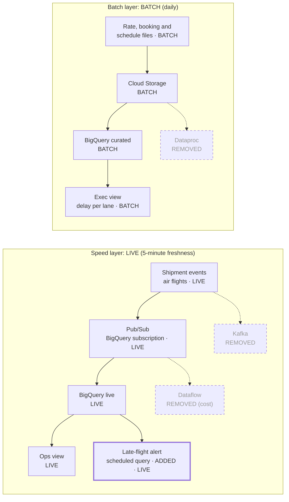

# Brightwave Electronics (SHP03): platform architecture

Adapted from the course reference platform (`architecture/README.md`) for our launch customer, Brightwave Electronics.

**Targets:** freshness 5 minutes · reliability 98% on time on every lane · budget $35 per month
**Legend:** **LIVE** = must meet the 5-minute freshness target · **BATCH** = runs on a daily schedule · dashed = removed from the reference · thick border = added

## Live or batch

| Box | Live or batch | Why |
|---|---|---|
| Shipment events → Pub/Sub → BigQuery live → Ops view | LIVE | A late flight before a launch day must be visible within 5 minutes |
| Late-flight alert | LIVE | Ops must be told, not left to spot it on a dashboard |
| Rate, booking and schedule files → Cloud Storage → BigQuery curated | BATCH | Carriers send rates daily, and bookings and schedules arrive as daily files |
| Exec view (delay per lane) | BATCH | A monthly reliability trend doesn't need minute-level freshness |

## Changes from the reference

- **Added: late-flight alert.** Brightwave flies devices for launch days announced months ahead, and a missed one makes the news. A scheduled BigQuery query checks the live table every 5 minutes and alerts ops when a flight's actual time slips past its plan.
- **Removed: Kafka.** Three air lanes produce a small event volume that Pub/Sub alone can handle. Running a Kafka cluster as well would not fit a $35 per month budget.
- **Removed: Dataflow.** An always-on streaming worker costs about $51 per month, over the whole budget (see the cost check in ADR 001). A Pub/Sub BigQuery subscription writes events straight into the live table for under a cent a month, and still meets the 5-minute target.
- **Removed: Dataproc.** The batch data is about 2 MB a month. BigQuery SQL can do the transformations for far less than a Spark cluster.

## Evidence

From `docs/metrics.md`: all three lanes (DXB → FRA, PVG → ORD, SIN → LHR) were 100% on time in October, against a 98% target. Reliability is met today, so the platform's main job is to catch the rare late flight quickly and cheaply. From ADR 001's cost check: the adapted design costs under $1 per month, well inside the $35 budget.